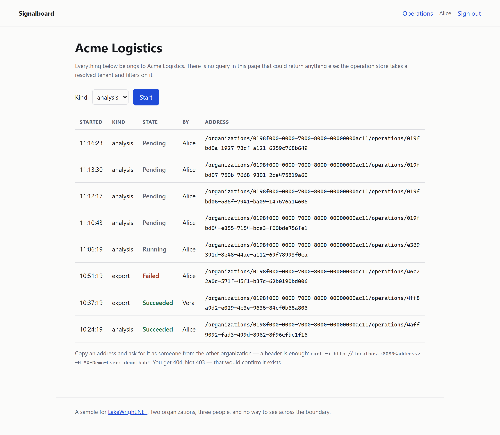

# LakeWright.NET

[](https://github.com/ivanvyd/LakeWright.NET/actions/workflows/ci.yml)
[](LICENSE)
[](global.json)
[](https://www.bestpractices.dev/projects/13968)
[](https://scorecard.dev/viewer/?uri=github.com/ivanvyd/LakeWright.NET)

The build kit for multi-tenant .NET SaaS on Databricks.

An opinionated reference architecture and a small set of reusable components for teams that sell
analytics to customers who are not themselves Databricks customers.

Project site: **<https://lakewright.net>** — the argument in one page, with the same three
identities you can run locally.

> **Status: early, but you can run it.**
> Implemented and tested: the tenant model ([LW-C047](docs/compatibility.md#lw-c047)), the
> tenant-scoped Databricks query layer ([LW-C003](docs/compatibility.md#lw-c003),
> [LW-C012](docs/compatibility.md#lw-c012)), the asynchronous operation worker with crash
> reconciliation and resumed polling ([LW-C054](docs/compatibility.md#lw-c054)), the ASP.NET Core
> tier (tenant middleware, role policies, the operations API with client idempotency;
> [LW-C056](docs/compatibility.md#lw-c056), [LW-C057](docs/compatibility.md#lw-c057)), the audit trail
> ([LW-C049](docs/compatibility.md#lw-c049), [LW-C050](docs/compatibility.md#lw-c050),
> [LW-C051](docs/compatibility.md#lw-c051)), the Declarative Automation Bundle
> ([LW-C031](docs/compatibility.md#lw-c031)), telemetry instruments
> ([LW-C058](docs/compatibility.md#lw-c058)), and the Signalboard sample
> ([LW-C060](docs/compatibility.md#lw-c060)) — two organizations, three people, a Blazor dashboard
> and the same API from a terminal.
> Opt-in OpenTelemetry export wiring ([LW-C008](docs/compatibility.md#lw-c008)) and an Azure
> reference deployment template ([LW-C007](docs/compatibility.md#lw-c007)) are included.
> Currency billing integration is implemented locally; its live system-table read
> ([LW-C006](docs/compatibility.md#lw-c006)) and the first reference deployment remain unverified.
> Currency budgets remain open. The
> milestones are in [ROADMAP.md](ROADMAP.md), and
> [docs/compatibility.md](docs/compatibility.md) records exactly what has been verified against a
> live workspace and what has not.



## Run it

For an existing application, start with the [published-package quickstart](examples/package-quickstart/README.md):
trusted membership resolution, one tenant-scoped SQL query, and wrong-tenant denial in a standalone
.NET 8 consumer of 3.1.0. Its offline HTTP fixture needs no workspace or PostgreSQL
([LW-C061](docs/compatibility.md#lw-c061)).

To run Signalboard, you need Docker. No .NET SDK, Databricks account, or configuration is required
([LW-C060](docs/compatibility.md#lw-c060)).

```bash
git clone https://github.com/ivanvyd/LakeWright.NET
cd LakeWright.NET/samples/Signalboard
docker compose up
```

Open <http://localhost:8080>. The landing page seeds two organizations and three people and hands
you the curl commands. Sign in as someone from the other organization and the same address answers
404 rather than 403, because a 403 would confirm the work exists
([LW-C047](docs/compatibility.md#lw-c047)).

That is the isolation model in about a minute, and it runs without a workspace because tenancy and
authorization never talk to Databricks. [Getting started](docs/guides/getting-started.md) goes on to
the tests, the DI wiring, and a live workspace.

## What problem this solves

A row filter based only on `session_user()` cannot distinguish tenants that share one service
principal ([LW-C022](docs/compatibility.md#lw-c022)). LakeWright resolves tenant membership in the
application and scopes SQL to that tenant's catalog and schema
([LW-C003](docs/compatibility.md#lw-c003), [LW-C047](docs/compatibility.md#lw-c047)). It also
provides durable asynchronous operations ([LW-C054](docs/compatibility.md#lw-c054)), per-tenant
compute limits ([LW-C055](docs/compatibility.md#lw-c055)) and auditing.

Databricks now supports [OAuth custom identity claims](https://learn.microsoft.com/en-us/azure/databricks/dev-tools/auth/oauth-custom-identity-claims).
Governed views or ABAC policies can use
[`current_oauth_custom_identity_claim()`](https://learn.microsoft.com/en-us/azure/databricks/sql/language-manual/functions/current_oauth_custom_identity_claim)
to filter rows under app identity. The server must derive the claim from authenticated membership,
deny rows when it is absent, and restrict grants so callers cannot bypass the policy. LakeWright's
built-in credentials do not mint these claims; its schema-per-tenant contract is unchanged
([LW-C065](docs/compatibility.md#lw-c065)).

SQL filtering does not isolate Genie conversation history
([LW-C035](docs/compatibility.md#lw-c035)). The application must authorize tenant
and owner access before reading or continuing a conversation, including when resuming accepted
messages. See [the conversation guide](docs/guides/genie-conversations.md).

## What this is not

- Not a Databricks SDK. [`Microsoft.Azure.Databricks.Client`](https://www.nuget.org/packages/Microsoft.Azure.Databricks.Client)
  already covers Unity Catalog, Statement Execution and Jobs under MIT. This project depends on it
  ([LW-C062](docs/compatibility.md#lw-c062)).
- Not a dashboard embedding library. Databricks AI/BI external embedding ships today and filters
  rows per viewer ([LW-C064](docs/compatibility.md#lw-c064)). Use it. `LakeWright.Embedding` brokers the *token* that flow needs
  ([LW-C037](docs/compatibility.md#lw-c037)) and stops there — the tenant is signed into it rather
  than chosen by the caller ([LW-C038](docs/compatibility.md#lw-c038)). Rendering remains
  `@databricks/aibi-client`'s job.
- Not a generic ASP.NET Core SaaS starter. If you are not on Databricks, nothing here is for you.
- Not an admin portal, a workspace provisioner, or a notebook tutorial.

## Why the application runs outside Databricks

Databricks Apps documentation states: "You can't make Databricks apps public. Anonymous access and
bypassing single sign-on (SSO) are not supported." Every end user must exist as an identity in your
Databricks account, an app's address cannot be changed, and the runtime ships Python and Node with
no .NET ([LW-C063](docs/compatibility.md#lw-c063)).

Databricks Apps is the right host for internal tooling. It cannot host a customer-facing product
([LW-C024](docs/compatibility.md#lw-c024)). If your users can hold Databricks identities, or only
need embedded dashboards, read [When not to use LakeWright](docs/guides/when-not-to-use-lakewright.md)
first.
[ADR 0001](docs/decisions/0001-host-the-application-outside-databricks.md) records the evidence and
settles it.

## Planned repository layout

Projects appear when there is code to put in them, so this grows over the milestones in
[ROADMAP.md](ROADMAP.md). What exists today:

```
src/
  LakeWright.Core/            tenancy and job contracts
  LakeWright.Databricks/      tenant-scoped Databricks SQL and job access
  LakeWright.Multitenancy/    tenant model, resolution, operations, audit, EF Core
  LakeWright.AspNetCore/      tenant middleware, role policies, operations API
  LakeWright.AI/              Databricks model serving as an IChatClient, optional
  LakeWright.Embedding/       scoped tokens for AI/BI dashboards, optional
  LakeWright.Conversations/   tenant-scoped Genie, optional
  LakeWright.Caching.Redis/   Redis-backed Genie conversation ownership, optional
samples/
  Signalboard/                two-tenant sample product, Blazor dashboard plus the API
tests/
  LakeWright.TenantIsolation.Tests/   the suite the rest of it rests on
databricks/                   Declarative Automation Bundle, dev and prod targets
docs/                         see docs/README.md
```

`LakeWright.Multitenancy` does not reference `LakeWright.Databricks`, so adopting the tenancy tier
alone does not drag in the Databricks client. A test enforces that rather than a convention
([LW-C059](docs/compatibility.md#lw-c059)).

The sample includes opt-in OpenTelemetry export wiring ([LW-C008](docs/compatibility.md#lw-c008)).
Currency attribution has a billing-reader implementation ([LW-C006](docs/compatibility.md#lw-c006)),
and Azure deployment has Bicep templates and a workflow ([LW-C007](docs/compatibility.md#lw-c007)).
Their live verification boundaries are recorded in [the compatibility matrix](docs/compatibility.md).

Verified stable release at this source snapshot: [v3.1.0](https://github.com/ivanvyd/LakeWright.NET/releases/tag/v3.1.0).
The source tree may contain changes for a later candidate; published packages retain the behavior
documented in [the release evidence](docs/release-evidence/v3.1.0.md).

## Documentation

[docs/README.md](docs/README.md) is the index. The ones most people want:

| Document | What it answers |
|---|---|
| [Getting started](docs/guides/getting-started.md) | Running the tests, and wiring it into an application |
| [Architecture](docs/planning/03-architecture.md) | The three planes, what lives where, and why |
| [Tenant model](docs/planning/04-tenant-model.md) | The isolation decision matrix and the recommended default |
| [Threat model](docs/security/threat-model.md) | What is protected, from what, and which threats are unmitigated |
| [Compatibility](docs/compatibility.md) | Verified against a live workspace, versus taken from documentation |
| [SOC 2 mapping](docs/compliance/soc2-mapping.md) | Which controls exist, which are partial, and which are the adopter's problem |
| [Testing isolation](docs/guides/testing-isolation.md) | How the isolation suite is shown to fail when isolation is broken |
| [Decisions](docs/decisions) | One record per load-bearing choice |
| [Roadmap](ROADMAP.md) | What is next, what is open, and what nobody has checked |

## Support boundary

This is a community project maintained in personal time. It is provided for your exploration only,
it carries no service-level agreement, and it is provided as-is without warranties or guarantees of
any kind. Do not open Databricks support tickets about it.

[docs/compatibility.md](docs/compatibility.md) records which Databricks features have been verified
against a live workspace and which have not. Anything not listed as verified should be treated as
unverified.

## Trademarks

Databricks is a trademark of Databricks, Inc. This project is not affiliated with, endorsed by, or
sponsored by Databricks, Inc.

.NET is a trademark of Microsoft Corporation. This project is not affiliated with, endorsed by, or
sponsored by Microsoft Corporation.

## License

[Apache-2.0](LICENSE).
